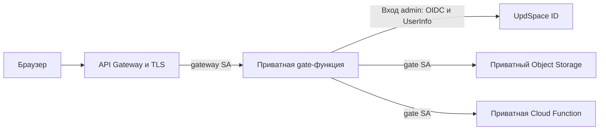

# Сайт лабораторных

`labs.spbetu.ru` публикует лабораторные и PDF-отчёты из `site/labs.json`.
Работы с `access: "admin"` доступны после входа через UpdSpace ID пользователям
из списка администраторов. Основной ЛК работает отдельно на `spbetu.ru`.

