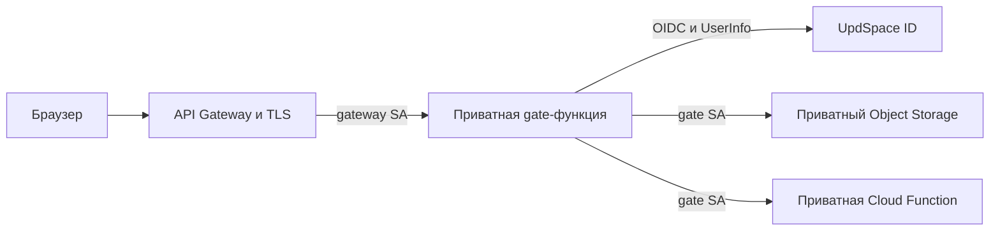

# Защищённый сайт лабораторных

`labs.spbetu.ru` содержит шесть работ: 1, 2, 3, 4, 5 и 7, их PDF-отчёты
и каталог. Доступ получают владелец и явно добавленные пользователи
UpdSpace ID. Основной ЛК остаётся на `spbetu.ru` со своим origin,
OIDC client, Caddy и данными.

Gate проверяет сессию и точную пару `(issuer, sub)` перед каждым защищённым
ответом, включая CSS, JS, изображения, PDF и API. Allowlist по умолчанию
пуст. Каждый запрос проверяется через live UserInfo; недоступность ID,
истёкший или отозванный token закрывают доступ. Ответы не попадают в общий
публичный кеш. Локальный кеш неизменяемых объектов не заменяет проверку
пользователя.

Вход использует Authorization Code, PKCE S256, state и nonce.
Cookie содержит зашифрованную AES-GCM сессию и имеет `HttpOnly`, `Secure`,
`SameSite=Lax`; refresh token не хранится. Срок ограничен сроком access token.
Logout очищает cookie и отзывает token. OIDC client secret и ключ cookie
поступают из конкретной версии Lockbox только в gate.

API Gateway вызывает приватную gate-функцию от своего SA по закреплённому
тегу. Формат event `1.0` передаёт Cookie, Origin и повторяющиеся заголовки
через headers/multiValueHeaders. Перед публикацией нужно проверить вход,
несколько Set-Cookie и точные байты бинарных файлов; подробности в
[runtime acceptance](02-release/RUNTIME.md#cookies-и-шлюз).
Публичны только необходимые auth endpoints и `/healthz`, который сообщает
состояние конфигурации без пользовательских данных.

Браузер получает файлы через gate. Бакет не имеет website endpoint,
анонимного доступа или presigned URL. SA gate читает только `releases/*`;
metadata IAM token позволяет работать с [S3 API](https://yandex.cloud/en/docs/storage/api-ref/authentication)
без постоянного access key. Quote function получает запрос только после
проверки пользователя и не имеет доступа к Lockbox или файлам.

`GET /api/v1/quote` возвращает объект с `schemaVersion: 1`, `id`, `text`,
`language` и `attribution`. Общий модуль `services/quotes/contract.mjs`
проверяет его в функции, gate и браузере. Версия v1 сохраняется совместимой
при изменении набора цитат. Бизнес-данные функции входят в её ZIP-артефакт.

## Два этапа

| Этап | Управляемые ресурсы | Вход для следующего этапа |
|---|---|---|
| `01-foundation` | Приватный bucket, gate/gateway/quote/release SA, IAM, Lockbox metadata, DNS-сертификат | `release_config`, challenges сертификата |
| `02-release` | ZIP и environment версии gate, версия quotes, invoker bindings, gateway и привязка домена | `release_tuple`, DNS CNAME, результаты приёмки |

State разделён на `foundation.tfstate` и `release.tfstate` в отдельном
приватном бакете. Секреты входа в state не записываются, но state и plans
всё равно доступны только операторам. Bootstrap state, федерации GitHub
и назначения прав оператора выполняется отдельно с согласованными
cloud/folder. Для OpenTofu 1.13.0 выбран native S3 lock (`use_lockfile=true`).
До первого apply обязателен тест конкурирующих процессов на отдельном key
нового бакета; до его успеха CI apply выключен. GitHub concurrency не заменяет
блокировку backend. VPC и БД не создаются.

Первые foundation/runtime apply выполняет владелец через существующий вход YC.
Затем WIF-операторы получают права только на созданные ресурсы и их SA.
Роли администратора общего каталога CI не выдаются.

CI собирает единый allowlist файлов, проверяет ссылки, стили, JS и PDF,
сохраняет manifest с размерами и SHA-256. Upload записывает объекты
в `releases/<gitSHA>/<manifestSHA256>/` и сверяет их содержимое.
Gate проверяет manifest по ожидаемому digest. Gateway переключается на
тег новой версии gate после её создания; прежний набор остаётся для отката.
Hash gate включает ZIP и всю конфигурацию, в том числе allowlist, manifest
и Lockbox version. Quote tag зависит от ZIP digest. В outputs попадает
конечный hash конфигурации без значений allowlist. Container Registry
и Serverless Containers не используются.

Upload-аккаунт имеет права только на свой release prefix в Object Storage. Terraform
использует отдельного оператора, поскольку управление invoker bindings
требует административных прав соответствующих сервисов. Federation доверяет
конкретным GitHub environment subjects репозитория `m4tveevm/etu_web`.
PR jobs выполняют проверки без production credentials.

## Границы проверки

`fmt` и `validate` проверяют конфигурацию с provider `0.206.0`.
Облачные plan/apply, DNS, сертификат, Lockbox payload, регистрация клиента
и вход пользователя требуют отдельной проверки на реальных ресурсах.
Перед apply пользователь получает конкретный план изменений.

Сайт считается готовым после успешного входа владельца, отказа постороннему,
отзыва доступа и проверки каждого типа файла через публичный домен.
Анонимные запросы к origin и backend должны получать отказ. Откат проверяется
на сохранённом tuple без удаления предыдущих объектов. Эти операции не должны
менять ЛК, общий Caddy, существующие DNS-записи или ресурсы промо.
